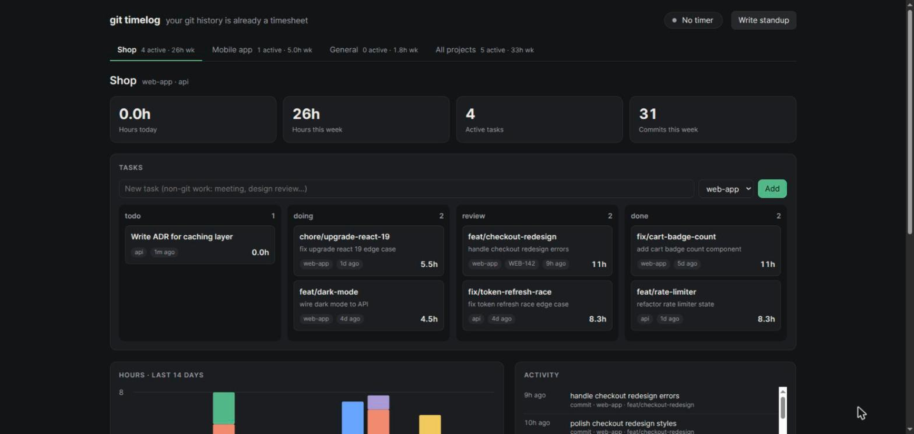
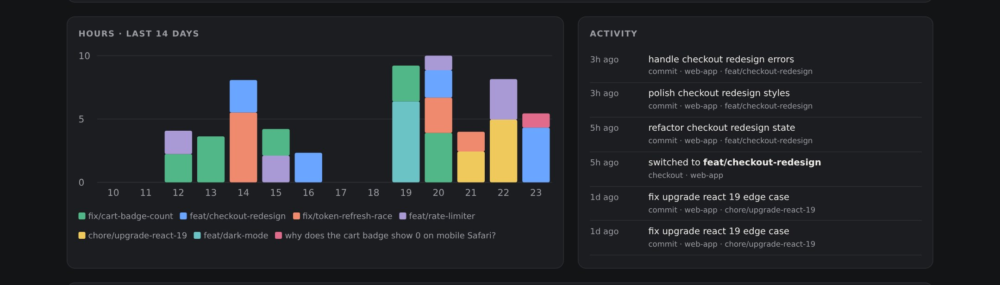

# git timelog

**Your git history is already a timesheet.**

`git timelog` is a time tracker you never have to start. Every branch becomes a task,
every checkout and commit becomes a data point, and a local dashboard shows where your
hours went. No account, no cloud, no browser extension, no Electron app.





## Why

Time trackers like Clockify or Toggl only work if you remember to press start.
Developers already leave a precise trail of what they worked on and when: it's called git.
`git timelog` reads that trail.

- **Zero effort.** Git hooks record branch switches, commits and merges as they happen.
- **Branches are tasks.** `feat/login` shows up on the board the first time you touch it.
  When it's merged (merge commit or fast-forward), the task moves to *done*.
- **One dashboard, many projects.** Each project gets its own tab with its own board,
  totals, chart and activity feed. Group several repos into one project if you like.
- **Private.** Everything stays in a SQLite file on your machine.
- **Tiny.** One Python file, standard library only. Nothing to `pip install`.
- **No background process.** On Linux, systemd holds the port and starts the dashboard
  only when you open it; it exits after 10 idle minutes.
- **Daily standup notes.** A Markdown note per day (Obsidian-friendly) with what you committed,
  hours per task and what's in progress.

## Install

Requires `git` (2.31+) and `python3` (3.8+). Linux with systemd gets the on-demand dashboard and the
scheduled standup note; macOS and others run the dashboard with `git timelog serve`.

```sh
git clone https://github.com/tmtony98/git-timelog.git
cd git-timelog
./install.sh
```

Then, in each repository you want to track:

```sh
cd ~/code/my-app
git timelog init          # installs hooks and imports the last 30 days
git timelog open          # http://localhost:7777
```

Because the command is named `git-timelog`, git exposes it as a subcommand: `git timelog`.

## Usage

```sh
git timelog ls                         # open tasks with hours (--all for done)
git timelog log 45m "code review"      # add time to the current branch
git timelog log "Sprint planning" 1h   # add time to a named task
git timelog add "Design review"        # a task that isn't a branch
git timelog start / stop               # manual timer (current branch by default)
git timelog status feat/login review   # todo | doing | review | done
git timelog set feat/login ticket WEB-142
git timelog report                     # write today's standup note
git timelog repos | remove             # list or stop tracking repos
```

On the dashboard you can drag cards between columns, start timers, log time and attach a
ticket or PR link.

## Projects and tabs

Every tracked repo is a project, and every project gets a tab at the top of the dashboard.
The tab shows its active task count and hours this week; the selected tab shows only that
project's board, totals, 14-day chart, activity feed and task table. **All projects** shows
everything together.

- **Switching:** click a tab. The choice is kept in the URL, so `http://localhost:7777/#Shop`
  opens straight on the Shop project (bookmark one per project), and the dashboard reopens on
  the last tab you used.
- **Grouping repos:** to put several repos under one tab (frontend + backend, say), list them
  in the `[projects]` section of the config. Names are the repo folder names:

  ```ini
  [projects]
  Shop = web-app, api
  Mobile app = mobile
  ```

  Repos not listed get a tab of their own. Tasks you add without a repo appear under **General**.
- **Adding a task** from a tab offers that project's repos in the dropdown.

## How a task moves between columns

| Happens | Status |
|---|---|
| First checkout or commit on a new branch | **doing** |
| A merge commit names the branch (`Merge pull request #12 from you/feat-x`, `Merged in feat-x (pull request #12)`, `Merge branch 'feat-x'`) | **done** |
| The branch is already contained in a base branch such as `main` (fast-forward merge, no merge commit) and you committed on it | **done** |
| No activity for `stale_days` (7) when importing history | **done** |
| You switch back to, or commit on, a done branch | **doing** again |
| You drag the card or run `git timelog status` | whatever you chose; older merges never override it |

A branch you only created (no commits of your own yet) is never treated as merged, even
though it sits inside `main`. Merge detection runs whenever new events arrive and at most
every 5 minutes while the dashboard is open.

## Worktrees

`git worktree` checkouts count as the same repo: tasks from `~/code/shop` and
`~/code/shop-feature-x` are both filed under `shop`. Hooks live in the shared `.git`
folder, so one `git timelog init` covers every worktree. Run `init` inside each extra
worktree too if you want its branch-switch history imported.

## How time is estimated

Events are walked in time order. The gap between two events is credited to the branch you
were on: for a commit, the branch it was made on; for a branch switch, the branch you were
leaving. Only gaps under 2 hours count. After a longer gap a new
session starts, and its first commit gets a 30 minute lead-in. This is the same idea as
[git-hours](https://github.com/kimmobrunfeldt/git-hours), applied to checkouts as well as
commits.

It's an estimate. Long stretches of uncommitted work are undercounted, and a meeting in the
middle of a branch is counted as work on it. Use `git timelog log`
or the timer to correct it. Manual time is added on top of git time.

## Configuration

`~/.config/git-timelog/config.ini` (all optional):

```ini
[git-timelog]
author =                       ; default: each repo's user.email
base_branches = main,master,develop,dev,staging,prod,release/*
session_gap_min = 120
lead_in_min = 30
stale_days = 7                 ; idle branches are marked done after backfill
idle_exit_min = 10
port = 7777                    ; re-run install.sh with PORT=... to change the socket
standup_dir = ~/Documents/git-timelog/standups
title = git timelog

[projects]                     ; optional: group repos under one tab
Shop = web-app, api
```

Point `standup_dir` into your Obsidian vault to get notes there.

## Where things live

| What | Path |
|---|---|
| Command | `~/.local/bin/git-timelog` |
| Data (SQLite + hook event log) | `~/.local/share/git-timelog/` |
| Config | `~/.config/git-timelog/config.ini` |
| systemd units | `~/.config/systemd/user/git-timelog*` |
| Hooks | one line appended to `post-checkout`, `post-commit`, `post-merge` in each tracked repo |

Existing hooks are kept; `git timelog` adds a single marked line and `git timelog remove`
takes it out again. If a repo sets `core.hooksPath` to a folder inside the project
(Husky and similar), `init` doesn't touch those files and prints the one line to add yourself.

## Try it without your own data

```sh
GIT_TIMELOG_HOME=/tmp/gtl-demo git timelog demo
GIT_TIMELOG_HOME=/tmp/gtl-demo git timelog serve --port 7788
```

## Uninstall

```sh
./uninstall.sh            # removes command, hooks and services; keeps your data
./uninstall.sh --purge    # also deletes data and config
```

## Development

```sh
python3 -m unittest discover tests
```

The tests run the real CLI against throwaway git repositories.

## Contributing

Contributions are welcome! Bug reports, ideas and pull requests all help.
See [CONTRIBUTING.md](CONTRIBUTING.md) for setup, project principles and ideas to pick up.

## License

MIT
