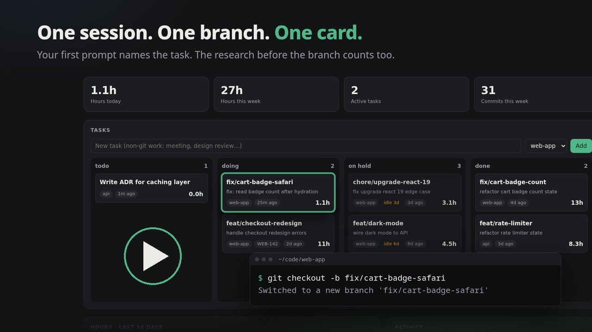

# git timelog

**Task and time tracking for agentic coding. You never press start.**

Every coding-agent session and every git branch becomes a task, with its hours filled in for you.

- **Ask your agent something** (Claude Code, Codex, Gemini CLI or Cursor) and the task starts.
- **It creates a branch**, and the work and the research before it land on that branch's card.
- **The PR merges**, and the task moves to done.

A local dashboard shows every project, task and hour, and your daily standup note is written
for you (automatically each weekday evening on Linux). It runs on your machine: no account,
no cloud, nothing to `pip install`.

[](https://github.com/tmtony98/git-timelog/releases/download/v0.7.0/git-timelog-launch.mp4)

▶ **[Watch the 30-second launch video](https://github.com/tmtony98/git-timelog/releases/download/v0.7.0/git-timelog-launch.mp4)** (mp4, 4 MB)


## Why

Time trackers like Clockify or Toggl only work if you remember to press start.
Developers already leave a precise trail of what they worked on and when: it's called git.
`git timelog` reads that trail.

- **Zero effort.** Git hooks record branch switches, commits and merges as they happen.
- **Coding-agent sessions count too.** With one hook, every Claude Code, Codex, Gemini CLI or
  Cursor session is tracked from its first prompt, including research that never touches a
  branch.
- **Branches are tasks.** `feat/login` shows up on the board the first time you touch it.
  When it's merged (merge commit or fast-forward), the task moves to *done*.
- **One dashboard, many projects.** Each project gets its own tab with its own board,
  totals, chart and activity feed. Group several repos into one project if you like.
- **Private.** Everything stays in a SQLite file on your machine.
- **Tiny.** One Python file, standard library only. Nothing to `pip install`.
- **No background process.** On Linux, systemd holds the port and starts the dashboard
  only when you open it; it exits after 10 idle minutes.
- **Daily standup notes.** A Markdown note per day (Obsidian-friendly) with what you committed,
  hours per task and what's in progress.

## Install

Requires `git` (2.31+) and `python3` (3.8+), plus [`jq`](https://jqlang.github.io/jq/) if you
want coding-agent sessions tracked. Linux with systemd gets the on-demand dashboard and the
scheduled standup note; macOS and others run the dashboard with `git timelog serve`. Windows
isn't supported.

```sh
git clone https://github.com/tmtony98/git-timelog.git
cd git-timelog
./install.sh
```

Then, in each repository you want to track:

```sh
cd ~/code/my-app
git timelog init          # installs hooks and imports the last 30 days
git timelog open          # http://localhost:7777
```

Because the command is named `git-timelog`, git exposes it as a subcommand: `git timelog`.

## Usage

```sh
git timelog ls                         # open tasks with hours (--all for done)
git timelog log 45m "code review"      # add time to the current branch
git timelog log "Sprint planning" 1h   # add time to a named task
git timelog add "Design review"        # a task that isn't a branch
git timelog start / stop               # manual timer (current branch by default)
git timelog status feat/login hold     # todo | doing | hold | done
git timelog delete feat/lookup         # hide a task and its time (git timelog restore undoes it)
git timelog set feat/login ticket WEB-142
git timelog report                     # write today's standup note
git timelog repos | remove             # list or stop tracking repos
git timelog agent-setup codex --write  # track coding-agent sessions: claude | codex | gemini | cursor
```

On the dashboard you can drag cards between columns, start timers, log time, attach a
ticket or PR link, and delete a task (click Delete twice; Undo appears for a few seconds).

Deleting hides the task and its hours from the board, totals and standup notes but keeps the
record, so switching to that branch again doesn't bring it back. Committing on it does, since
you're working on it again. `git timelog restore <task>` undoes a delete at any time.

## Projects and tabs

Every tracked repo is a project, and every project gets a tab at the top of the dashboard.
The tab shows its active task count and hours this week; the selected tab shows only that
project's board, totals, 14-day chart, activity feed and task table. **All projects** shows
everything together.

- **Switching:** click a tab. The choice is kept in the URL, so `http://localhost:7777/#Shop`
  opens straight on the Shop project (bookmark one per project), and the dashboard reopens on
  the last tab you used.
- **Grouping repos:** to put several repos under one tab (frontend + backend, say), list them
  in the `[projects]` section of the config. Names are the repo folder names:

  ```ini
  [projects]
  Shop = web-app, api
  Mobile app = mobile
  ```

  Repos not listed get a tab of their own. Tasks you add without a repo appear under **General**.
- **Adding a task** from a tab offers that project's repos in the dropdown.

## How a task moves between columns

| Happens | Status |
|---|---|
| First checkout or commit on a new branch | **doing** |
| A merge commit names the branch (`Merge pull request #12 from you/feat-x`, `Merged in feat-x (pull request #12)`, `Merge branch 'feat-x'`) | **done** |
| The branch is already contained in a base branch such as `main` (fast-forward merge, no merge commit) and you committed on it | **done** |
| A base branch has the same changes as copies: one commit with the branch's whole diff (squash merge) or every commit replayed (rebase merge) | **done** |
| The branch's remote copy was deleted (`git fetch --prune` shows it as gone), as hosts do after merging a PR | **done** |
| Not merged, and you haven't been on the branch for `idle_hold_days` (3) | **on hold** (card shows "idle 5d") |
| No activity for `stale_days` (7) when importing history | **done** |
| You switch back to, or commit on, a held or done branch | **doing** again |
| You drag the card or run `git timelog status` | whatever you chose; older merges never override it |
| An agent session asks its first question on a base branch | **doing** (an "agent session" card) |
| That session later works on a feature branch | its card is folded into the branch's card |
| A research-only session closes, or is idle for `session_done_hours` (12) | **done** |

"Been on the branch" means you committed on it, switched to it or switched away from it, so
branches you only checked out to test or look around also go on hold. Moving a held card back
to doing yourself gives it another `idle_hold_days` before the rule applies again. Cards you
put on hold by hand say "on hold" instead of "idle Nd".

Squash and rebase detection compares the changes themselves (git patch ids), not commit ids,
and writes nothing to your repo. A squash is only recognised if the squash commit has exactly
the branch's combined diff; if conflicts were resolved differently during the merge, close the
task by hand.

A branch you only created (no commits of your own yet) is never treated as merged, even
though it sits inside `main`. Merge detection runs whenever new events arrive and at most
every 5 minutes while the dashboard is open.

## Coding-agent sessions

Coding agents change how work starts: you open a session, ask questions and read code, and
only then create a branch. git timelog tracks the session itself, so that time isn't lost.

**What you get**

| Situation | On the board |
|---|---|
| A session researching on `main` (or in a folder above your repos) | A card named after your first prompt, with an "agent session" label |
| The session then works on a branch, for example after the [`main` guard](#optional-keep-claude-code-off-main) makes it create one | One card for the branch; the research time before it is folded in |
| A session started on a feature branch | Its time goes straight to that branch's card |
| You open the agent and quit without asking anything | No card |
| A research-only session closes, or goes quiet for 12 hours | Done |

No branch is ever created for you, so there is nothing to clean up afterwards.

**Resume a session from its card.** Click a card to see its sessions. For Claude Code and Codex
sessions the panel has a **Copy resume command** button, e.g.
`cd ~/code/shop && claude --resume <session-id>` or `codex resume <session-id>`, so you can pick
up exactly where that conversation left off. Gemini CLI resumes by list position and Cursor
conversations can't be resumed from a shell, so those get a copyable session id only.

**How session time is counted**

- While the agent is working on your request, the time counts, even a 40 minute run (up to
  `session_gap_min`).
- Between turns, your reading and testing time counts up to `agent_gap_min` (20 minutes); a
  longer pause means you were away.
- Where git activity and agent turns overlap on the same task, each minute is counted once.

**Setup**

One hook script, `~/.local/share/git-timelog/hooks/agent-hook.sh` (installed by
`install.sh`), works for every supported agent. Let git timelog add it to your agent's config:

```sh
git timelog agent-setup claude --write    # ~/.claude/settings.json
git timelog agent-setup codex --write     # ~/.codex/hooks.json, then run /hooks in Codex to trust it
git timelog agent-setup gemini --write    # ~/.gemini/settings.json
git timelog agent-setup cursor --write    # ~/.cursor/hooks.json
```

`--write` only touches the `hooks` part of the file, keeps everything else, saves a backup next
to it (`settings.json.git-timelog.bak`), and does nothing if the hooks are already there. It
refuses to touch a file that isn't valid JSON, or an agent that isn't installed.
`--remove` takes the hooks out again. Without either flag the command just prints the config,
so you can add it by hand.

For example, for Claude Code this is what gets added (the same block repeats for
`UserPromptSubmit`, `Stop` and `SessionEnd`):

```json
{
  "hooks": {
    "SessionStart": [
      { "hooks": [{ "type": "command", "command": "/home/you/.local/share/git-timelog/hooks/agent-hook.sh", "timeout": 5 }] }
    ]
  }
}
```

**What the hook writes down, and what it doesn't**

- For each event: the time, the session id, which agent it was, the folder it ran in, the repo and
  the current branch. For the session's
  first prompt, also its first 80 characters, used as the card title. Nothing else from the
  conversation.
- Only sessions inside repos you track, or folder names listed under `[projects]`, are written
  at all. Sessions anywhere else leave no trace. (git timelog keeps the hook's list of allowed
  names in `~/.local/share/git-timelog/tracked-repos`.)
- Prefer no prompt text on disk? Set `agent_titles = off`; cards are then called "Agent session".
- It needs `jq`. `install.sh` and `agent-setup` warn if it's missing; without it, sessions just
  aren't tracked. It never blocks or slows the agent noticeably (about 20 ms per event).

Sessions started in a parent folder that holds several repos count once you add that folder's
name to a project, e.g. `Shop = web-app, api, shop-workspace`.

Claude Code and Codex were checked against their documented hook payloads and Claude Code
also live; Gemini CLI and Cursor against their documentation. Gemini CLI may need hooks
switched on in its settings, depending on the version.

## Optional: keep Claude Code off `main`

git timelog treats each branch as one task, so work done directly on `main` never gets a card.
If you use [Claude Code](https://claude.com/claude-code), you can add a hook that refuses
edits while you're on `main` and asks for a branch first. Put this in your project's
`.claude/settings.json` (commit it so the whole team gets it):

```json
{
  "hooks": {
    "PreToolUse": [
      {
        "matcher": "Edit|Write",
        "hooks": [
          {
            "type": "command",
            "command": "f=$(jq -r \".tool_input.file_path // empty\"); case \"$f\" in \"$CLAUDE_PROJECT_DIR\"/*) ;; *) exit 0 ;; esac; b=$(git -C \"$CLAUDE_PROJECT_DIR\" branch --show-current); if [ \"$b\" = \"main\" ]; then echo \"Blocked: you are on main. Create a branch first: git checkout -b feat/<short-name>\" >&2; exit 2; fi; exit 0",
            "timeout": 10
          }
        ]
      }
    ]
  }
}
```

On `main`, Claude's edits are blocked with a message telling it to run
`git checkout -b feat/<short-name>`; on any other branch nothing changes. Notes:

- Needs [`jq`](https://jqlang.github.io/jq/). Without it the hook silently allows everything.
- It only guards Claude's Edit and Write tools. Shell commands such as `sed -i`, and your own
  edits, aren't affected.
- Using `master` or another default branch? Change `"main"` in the command.
- Files outside the project folder are never blocked.

### Other coding agents

Cursor, Codex, Copilot, Aider, Gemini and friends have no hook like this, but you can ask them
the same thing. Paste this into the file your agent reads for project rules (`AGENTS.md`,
`CLAUDE.md`, `.cursor/rules`, `.github/copilot-instructions.md`, ...):

```text
Branch rule (one task = one branch):
- At the start of every session or terminal, run `git branch --show-current`.
- Never edit files on main, master or develop. Create a branch for the task first:
  `git checkout -b <type>/<short-name>` (for example feat/login-form or fix/cart-count).
- If you're already on a feature branch, check that it matches the current task.
  If the task is different, create or switch to the right branch instead of mixing work.
- Commit and switch branches only after saving or stashing your changes.
- To run several agents on the same repo at once, give each its own worktree:
  `git worktree add ../<repo>-<name> -b <type>/<name>`
```

This is a request, not a lock: an agent can ignore it, and only the Claude Code hook above
actually blocks edits. A new terminal doesn't always mean a new task, so the rule asks the agent
to decide from the task at hand.

## Worktrees

`git worktree` checkouts count as the same repo: tasks from `~/code/shop` and
`~/code/shop-feature-x` are both filed under `shop`. Hooks live in the shared `.git`
folder, so one `git timelog init` covers every worktree. Run `init` inside each extra
worktree too if you want its branch-switch history imported.

## How time is estimated

Events are walked in time order. The gap between two events is credited to the branch you
were on: for a commit, the branch it was made on; for a branch switch, the branch you were
leaving. Only gaps under 2 hours count. After a longer gap a new
session starts, and its first commit gets a 30 minute lead-in. This is the same idea as
[git-hours](https://github.com/kimmobrunfeldt/git-hours), applied to checkouts as well as
commits.

With an [agent hook](#coding-agent-sessions) installed, agent turns are added on top of this
and overlapping minutes are merged.

It's an estimate. Without an agent hook, long stretches of uncommitted work are undercounted, and a meeting in the
middle of a branch is counted as work on it. Use `git timelog log`
or the timer to correct it. Manual time is added on top of git time.

## Configuration

`~/.config/git-timelog/config.ini` (all optional):

```ini
[git-timelog]
author =                       ; default: each repo's user.email
base_branches = main,master,develop,dev,staging,prod,release/*
session_gap_min = 120
lead_in_min = 30
idle_hold_days = 3             ; unmerged branch untouched this long -> on hold
agent_gap_min = 20             ; agent sessions: your time between turns counts up to this
session_done_hours = 12        ; research-only agent session idle this long -> done
agent_titles = prompt          ; "off" keeps prompt text out of the log and cards
stale_days = 7                 ; idle branches are marked done after backfill
idle_exit_min = 10
port = 7777                    ; re-run install.sh with PORT=... to change the socket
standup_dir = ~/Documents/git-timelog/standups
title = git timelog

[projects]                     ; optional: group repos under one tab
Shop = web-app, api
```

Point `standup_dir` into your Obsidian vault to get notes there.

## Where things live

| What | Path |
|---|---|
| Command | `~/.local/bin/git-timelog` |
| Data (SQLite + hook event log) | `~/.local/share/git-timelog/` |
| Config | `~/.config/git-timelog/config.ini` |
| systemd units | `~/.config/systemd/user/git-timelog*` |
| Hooks | one line appended to `post-checkout`, `post-commit`, `post-merge` in each tracked repo |
| Agent hook (optional) | `~/.local/share/git-timelog/hooks/agent-hook.sh`, referenced from your agent's config |

Existing hooks are kept; `git timelog` adds a single marked line and `git timelog remove`
takes it out again. If a repo sets `core.hooksPath` to a folder inside the project
(Husky and similar), `init` doesn't touch those files and prints the one line to add yourself.

## Try it without your own data

```sh
GIT_TIMELOG_HOME=/tmp/gtl-demo git timelog demo
GIT_TIMELOG_HOME=/tmp/gtl-demo git timelog serve --port 7788
```

## Uninstall

```sh
./uninstall.sh            # removes command, hooks and services; keeps your data
./uninstall.sh --purge    # also deletes data and config
```

## Development

```sh
python3 -m unittest discover tests
```

The tests run the real CLI against throwaway git repositories.

## Contributing

Contributions are welcome! Bug reports, ideas and pull requests all help.
See [CONTRIBUTING.md](CONTRIBUTING.md) for setup, project principles and ideas to pick up.

## License

MIT
