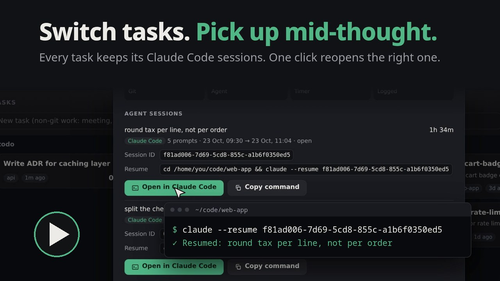
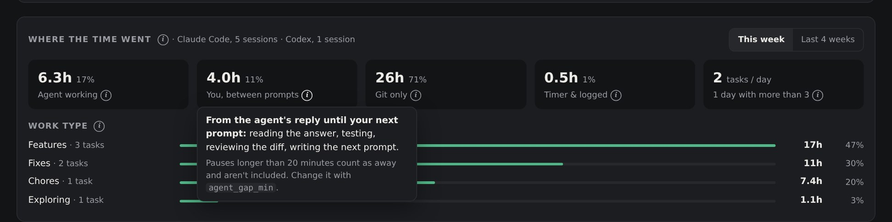
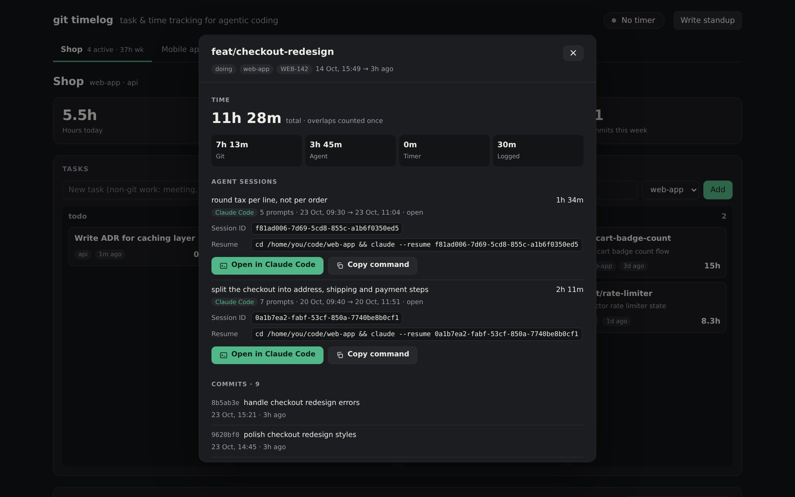

# git timelog

**Task and time tracking for agentic coding. You never press start.**

You juggle three features, a bug and a review, each with its own Claude Code conversation.
git timelog keeps every one of them on a card, with its hours, its commits and a button that
drops you straight back into that conversation.

[](https://github.com/tmtony98/git-timelog/releases/download/v0.8.0/git-timelog-explainer.mp4)

▶ **[Watch the 35-second explainer](https://github.com/tmtony98/git-timelog/releases/download/v0.8.0/git-timelog-explainer.mp4)** (mp4, 5 MB)


## Sound familiar?

Coding with agents is fast. Keeping track of it isn't.

- **"Which session was that fix in?"** You're pulled off a feature for an urgent bug. Two days
  later you come back and can't find the conversation where you and the agent had it half
  solved, so you explain everything again from scratch.
- **"What did I do yesterday?"** Standup starts in two minutes and you're scrolling git log and
  chat history to rebuild your day.
- **"How long did that take?"** Someone asks for an estimate, or a client needs hours. Your
  time tracker says zero, because you never pressed start. Nobody does.
- **"Did the agent actually save me time?"** You can't tell how much was the agent working and
  how much was you reading its output, testing and re-prompting.
- **"Where did the research go?"** An hour of asking questions and reading code before you
  even created a branch, and it's on no timesheet anywhere.
- **"Is this ticket still open?"** The board is out of date the moment a PR merges, because
  someone has to move the card.

## What git timelog does about it

| The pain | What happens instead |
|---|---|
| Losing your place when you switch tasks | Every task card lists its agent sessions. **Open in Claude Code** (or Codex) reopens that exact conversation, in the right folder, in a new terminal. Switch features freely and pick each one up mid-thought. |
| Rebuilding your day for standup | A standup note is written for you: what you committed, hours per task, what's in progress and on hold. |
| Time trackers you forget to start | Your agent's hooks and git already record when you work. Hours fill themselves in, per task. |
| Not knowing what the agent really costs | **Where the time went** splits your hours into *agent working*, *you, between prompts* and *git only*, plus what kind of work it was: features, fixes, chores, exploring. |
| Research that vanishes | A session that starts with a question is a task from its first prompt. When it turns into a branch, the research time comes with it. |
| A board nobody updates | Merged PRs move to done by themselves (merge, squash, rebase or fast-forward). Branches you've left alone go on hold, and coming back reopens them. |

**It's for you, not about you.** git timelog runs on your machine, keeps its data in one local
file, needs no account and sends nothing anywhere. It isn't built for monitoring anyone. You
decide what to share, for example your standup note.

## How it works, in short

- **Zero effort.** Agent hooks record each session's prompts and turns; git hooks record branch
  switches, commits and merges. Nothing to start or stop.
- **Sessions and branches become one task.** Research on `main` is its own card; once the
  session works on a branch, it folds into that branch's card.
- **The board runs itself.** Merged branches move to done (merge, squash, rebase or
  fast-forward); branches you left alone go on hold; coming back reopens them.
- **Every task explains itself.** Click a card for its time by source, its agent sessions and
  its commits, and jump back into a Claude Code or Codex session.
- **One dashboard, many projects.** A tab per project, each with its own board, totals, chart and
  activity feed.
- **Private and light.** One SQLite file on your machine. One Python script, standard library only.
  Nothing runs in the background: on Linux, systemd starts the dashboard when you open it and it
  exits after 10 idle minutes. Hooks take about 20 ms.

## Quick start

Requires `git` (2.31+), `python3` (3.8+) and [`jq`](https://jqlang.github.io/jq/) (for agent
sessions). Linux with systemd gets the on-demand dashboard and the scheduled standup note;
on macOS, run the dashboard with `git timelog serve`. Windows isn't supported.

```sh
git clone https://github.com/tmtony98/git-timelog.git && cd git-timelog && ./install.sh

cd ~/code/my-app && git timelog init         # in each repo: git hooks + the last 30 days
git timelog agent-setup claude --write       # or codex | gemini | cursor
git timelog open                             # http://localhost:7777
```

Because the command is named `git-timelog`, git exposes it as a subcommand: `git timelog`.

## The dashboard

- **Board:** todo · doing · on hold · done. Drag cards between columns; hover a card for
  Timer, Log time, Edit (ticket, PR link) and Delete (click twice; Undo appears for a few
  seconds). The done column shows its 8 newest cards, with "Show N more" for the rest.
- **Totals and chart:** hours today, hours this week, active tasks, commits this week, and hours
  per day for the last 14 days.
- **Activity feed:** recent commits, branch switches and merges.
- **Standup note:** "Write standup" (or `git timelog report`) writes today's Markdown note: what
  you committed, hours per task, what's in progress and on hold. On Linux it's also written every
  weekday at 18:30. Point `standup_dir` at your Obsidian vault to collect them there.


### Where the time went

Right under the board, for the selected project, this week or the last 4 weeks:



- **Who did the work:** *agent working* (from your prompt until the agent's reply), *you, between
  prompts* (from its reply until your next prompt, pauses under 20 minutes), *git only*
  (estimated from commits and branch switches, where no agent session was running), and *timer
  and logged* time. Every second is counted once, so the tiles add up to the tasks' hours.
- **Focus:** how many tasks you put 10+ minutes into on a typical day, and how many days you
  juggled more than 3.
- **Work type:** hours per type, from the branch name (`feat/`, `fix/`, `chore/`…) or else the
  commits' `feat:` / `fix:` style. Agent sessions that never reached a branch count as
  *exploring*.
- **Which agent:** shown next to the title (for example "Claude Code, 46 sessions").
- Each ⓘ explains its number in a popover.

### Task details

Click a card (or press Enter on it) to open its details. Escape or a click outside closes them.



| Section | What it shows |
|---|---|
| **Time** | Total, with overlapping minutes counted once, split into git, agent, timer and logged time |
| **Agent sessions** | Each session credited to the task: first-prompt title, agent, prompts, start and end, time, its full **session ID** and its **resume command** |
| **Commits** | Short id, message and date, newest first (the latest 50, with the total count) |
| **Timer & logged time** | Each entry with its note |

**Open in Claude Code** (or **Open in Codex**) opens a terminal in the session's folder and
resumes that conversation, for example `cd ~/code/shop && claude --resume <session-id>`.
**Copy command** gives you the same command to paste yourself.

- The terminal is the first of gnome-terminal, konsole, xfce4-terminal, kitty, alacritty,
  wezterm or x-terminal-emulator that's installed (Terminal.app on macOS); `terminal = <app>`
  picks one.
- Sessions recorded before git timelog knew which agent ran them are matched with Claude Code's
  and Codex's own session files (`~/.claude/projects`, `~/.codex/sessions`), so they get the
  button too.
- Gemini CLI resumes by list position and Cursor conversations reopen from Cursor's chat
  history, so those can't be opened from here.
- Only the dashboard page itself can ask for this, and the command is built from git timelog's
  own records, never from the request.

### Projects and tabs

Every tracked repo is a project with a tab showing its active tasks and hours this week.
**All projects** shows everything together.

- **Switching:** click a tab. The choice is kept in the URL, so `http://localhost:7777/#Shop`
  opens straight on the Shop project (bookmark one per project), and the dashboard reopens on
  the last tab you used.
- **Grouping repos:** to put several repos under one tab (frontend and backend, say), list them
  in the `[projects]` section of the config, by folder name. You can also add a parent folder
  that holds several repos, so agent sessions started there count:

  ```ini
  [projects]
  Shop = web-app, api, shop-workspace
  Mobile app = mobile
  ```

  Repos not listed get a tab of their own. Tasks you add without a repo appear under **General**.
- **Adding a task** from a tab offers that project's repos in the dropdown.

## Coding-agent sessions

| Situation | On the board |
|---|---|
| A session researching on `main` (or in a parent folder listed in a project) | A card named after your first prompt, with an "agent session" label |
| The session then works on a branch, for example after the [`main` guard](#keep-agents-on-branches) makes it create one | One card for the branch; the research time before it is folded in |
| A session started on a feature branch | Its time goes straight to that branch's card |
| You open the agent and quit without asking anything | No card |
| A research-only session closes, or goes quiet for 12 hours | Done |

No branch is ever created for you, so there's nothing to clean up afterwards.

**Which folder counts.** Agents report the folder a session is working in, and that can change
during the session. Each event is filed under the repo that folder belongs to (worktrees count as
their main repo), or under the folder's own name when it isn't a repo. Only names on the tracked
list are written down: your repos and the names under `[projects]`.

**How session time is counted**

- While the agent is working on your request, the time counts, even a 40 minute run (up to
  `session_gap_min`).
- Between turns, your reading and testing time counts up to `agent_gap_min` (20 minutes); a
  longer pause means you were away.
- Where git activity and agent turns overlap on the same task, each minute is counted once.

**Setup.** One hook script, `~/.local/share/git-timelog/hooks/agent-hook.sh` (installed by
`install.sh`), works for every supported agent:

```sh
git timelog agent-setup claude --write    # ~/.claude/settings.json
git timelog agent-setup codex --write     # ~/.codex/hooks.json, then run /hooks in Codex to trust it
git timelog agent-setup gemini --write    # ~/.gemini/settings.json
git timelog agent-setup cursor --write    # ~/.cursor/hooks.json
```

`--write` only touches the `hooks` part of the file, keeps everything else, saves a backup next
to it (`settings.json.git-timelog.bak`), and does nothing if the hooks are already there. It
refuses to touch a file that isn't valid JSON, or an agent that isn't installed. `--remove`
takes the hooks out again. Without either flag the command just prints the config, so you can
add it by hand. For Claude Code that's this block, repeated for `UserPromptSubmit`, `Stop` and
`SessionEnd`:

```json
{
  "hooks": {
    "SessionStart": [
      { "hooks": [{ "type": "command", "command": "/home/you/.local/share/git-timelog/hooks/agent-hook.sh", "timeout": 5 }] }
    ]
  }
}
```

**What the hook writes down, and what it doesn't**

- For each event: the time, the session id, which agent it was, the folder it ran in, the repo
  and the current branch. For the session's first prompt, also its first 80 characters, used as
  the card title. Nothing else from the conversation.
- Sessions in folders you don't track leave no trace: the hook checks a list of allowed names
  (`~/.local/share/git-timelog/tracked-repos`, kept up to date by git timelog) before writing.
- Prefer no prompt text on disk? Set `agent_titles = off`; cards are then called "Agent session".
- It needs `jq`. `install.sh` and `agent-setup` warn if it's missing; without it, sessions just
  aren't tracked. It never blocks the agent and takes about 20 ms per event.

Claude Code was tested live; Codex, Gemini CLI and Cursor against their documented hook
payloads. Gemini CLI may need hooks switched on in its settings, depending on the version.

## How a task moves between columns

| Happens | Status |
|---|---|
| First checkout or commit on a new branch | **doing** |
| An agent session asks its first question on a base branch | **doing** (an "agent session" card) |
| That session later works on a feature branch | its card is folded into the branch's card |
| A merge commit names the branch (`Merge pull request #12 from you/feat-x`, `Merged in feat-x (pull request #12)`, `Merge branch 'feat-x'`) | **done** |
| The branch is already contained in a base branch such as `main` (fast-forward merge) and you committed on it | **done** |
| A base branch has the same changes as copies: one commit with the branch's whole diff (squash merge) or every commit replayed (rebase merge) | **done** |
| The branch's remote copy was deleted (`git fetch --prune` shows it as gone), as hosts do after merging a PR | **done** |
| Not merged, and you haven't been on the branch for `idle_hold_days` (3) | **on hold** (card shows "idle 5d") |
| A research-only session closes, or is idle for `session_done_hours` (12) | **done** |
| No activity for `stale_days` (7) when importing history | **done** |
| You switch back to, or commit on, a held or done branch | **doing** again |
| You drag the card or run `git timelog status` | whatever you chose; older merges never override it |

"Been on the branch" means you committed on it, switched to it or switched away from it, so
branches you only checked out to test or look around also go on hold. Moving a held card back
to doing yourself gives it another `idle_hold_days` before the rule applies again. Cards you
put on hold by hand say "on hold" instead of "idle Nd".

Squash and rebase detection compares the changes themselves (git patch ids), not commit ids,
and writes nothing to your repo. A squash is only recognised if the squash commit has exactly
the branch's combined diff; if conflicts were resolved differently during the merge, close the
task by hand. A branch you only created (no commits of your own yet) is never treated as
merged, even though it sits inside `main`. Merge detection runs whenever new events arrive and
at most every 5 minutes while the dashboard is open.

## Keep agents on branches

git timelog treats each branch as one task, so work done directly on `main` never gets its own
card. Two ways to keep agents off it:

**Claude Code: a hook that blocks edits on `main`.** Put this in your project's
`.claude/settings.json` (commit it so the whole team gets it):

```json
{
  "hooks": {
    "PreToolUse": [
      {
        "matcher": "Edit|Write",
        "hooks": [
          {
            "type": "command",
            "command": "f=$(jq -r \".tool_input.file_path // empty\"); case \"$f\" in \"$CLAUDE_PROJECT_DIR\"/*) ;; *) exit 0 ;; esac; b=$(git -C \"$CLAUDE_PROJECT_DIR\" branch --show-current); if [ \"$b\" = \"main\" ]; then echo \"Blocked: you are on main. Create a branch first: git checkout -b feat/<short-name>\" >&2; exit 2; fi; exit 0",
            "timeout": 10
          }
        ]
      }
    ]
  }
}
```

On `main`, Claude's edits are blocked with a message telling it to run
`git checkout -b feat/<short-name>`; on any other branch nothing changes. It needs `jq` (without
it the hook allows everything), only guards Claude's Edit and Write tools (not shell commands or
your own edits), and never blocks files outside the project. Using `master`? Change `"main"`.

**Any other agent: a branch rule in its instructions.** Paste this into the file your agent
reads for project rules (`AGENTS.md`, `CLAUDE.md`, `.cursor/rules`,
`.github/copilot-instructions.md`, ...):

```text
Branch rule (one task = one branch):
- At the start of every session or terminal, run `git branch --show-current`.
- Never edit files on main, master or develop. Create a branch for the task first:
  `git checkout -b <type>/<short-name>` (for example feat/login-form or fix/cart-count).
- If you're already on a feature branch, check that it matches the current task.
  If the task is different, create or switch to the right branch instead of mixing work.
- Commit and switch branches only after saving or stashing your changes.
- To run several agents on the same repo at once, give each its own worktree:
  `git worktree add ../<repo>-<name> -b <type>/<name>`
```

This is a request, not a lock: an agent can ignore it. A new terminal doesn't always mean a new
task, so the rule asks the agent to decide from the task at hand.

## How time is estimated

Git events are walked in time order. The gap between two events is credited to the branch you
were on: for a commit, the branch it was made on; for a branch switch, the branch you were
leaving. Only gaps under 2 hours count. After a longer gap a new session starts, and its first
commit gets a 30 minute lead-in. This is the same idea as
[git-hours](https://github.com/kimmobrunfeldt/git-hours), applied to checkouts as well as commits.

Agent turns are added on top of this (see [how session time is counted](#coding-agent-sessions))
and overlapping minutes are merged. Timer and logged time are added on top of both.

It's an estimate. Without an agent hook, long stretches of uncommitted work are undercounted,
and a meeting in the middle of a branch is counted as work on it. Use `git timelog log` or the
timer to correct it.

## Command reference

```sh
git timelog init [path]                # track a repo: git hooks + import the last 30 days
git timelog repos | remove [path]      # list tracked repos, or stop tracking one
git timelog agent-setup claude --write # track agent sessions: claude | codex | gemini | cursor (--remove)
git timelog open | serve               # open the dashboard | run it in the foreground
git timelog ls [--all]                 # tasks with hours (--all includes done)
git timelog add "Design review"        # a task that isn't a branch
git timelog log 45m "code review"      # add time to the current branch
git timelog log "Sprint planning" 1h   # add time to a named task
git timelog start / stop               # manual timer (current branch by default)
git timelog status feat/login hold     # todo | doing | hold | done
git timelog set feat/login ticket WEB-142
git timelog delete feat/lookup         # hide a task and its time (restore undoes it)
git timelog report [YYYY-MM-DD]        # write the standup note
```

Deleting hides a task and its hours from the board, totals and standup notes but keeps the
record, so switching to that branch again doesn't bring it back. Committing on it does, since
you're working on it again.

## Configuration

`~/.config/git-timelog/config.ini` (all optional; the dashboard picks up changes without a
restart):

```ini
[git-timelog]
author =                       ; default: each repo's user.email
base_branches = main,master,develop,dev,staging,prod,release/*
session_gap_min = 120
lead_in_min = 30
idle_hold_days = 3             ; unmerged branch untouched this long -> on hold
agent_gap_min = 20             ; agent sessions: your time between turns counts up to this
session_done_hours = 12        ; research-only agent session idle this long -> done
agent_titles = prompt          ; "off" keeps prompt text out of the log and cards
terminal =                     ; app for "Open in Claude Code"; empty = first one found
stale_days = 7                 ; idle branches are marked done after importing history
idle_exit_min = 10
port = 7777                    ; re-run install.sh with PORT=... to change the socket
standup_dir = ~/Documents/git-timelog/standups
title = git timelog

[projects]                     ; optional: group repos (and parent folders) under one tab
Shop = web-app, api
```

## Where things live

| What | Path |
|---|---|
| Command | `~/.local/bin/git-timelog` |
| Data (SQLite + hook event log) | `~/.local/share/git-timelog/` |
| Config | `~/.config/git-timelog/config.ini` |
| systemd units | `~/.config/systemd/user/git-timelog*` |
| Git hooks | one line appended to `post-checkout`, `post-commit`, `post-merge` in each tracked repo |
| Agent hook | `~/.local/share/git-timelog/hooks/agent-hook.sh`, referenced from your agent's config |

Existing git hooks are kept; `git timelog` adds a single marked line and `git timelog remove`
takes it out again. If a repo sets `core.hooksPath` to a folder inside the project (Husky and
similar), `init` doesn't touch those files and prints the one line to add yourself.

**Worktrees** count as the same repo: tasks from `~/code/shop` and `~/code/shop-feature-x` are
both filed under `shop`. Hooks live in the shared `.git` folder, so one `git timelog init` covers
every worktree; run `init` inside each extra worktree too if you want its branch-switch history
imported.

## Try it without your own data

```sh
GIT_TIMELOG_HOME=/tmp/gtl-demo git timelog demo
GIT_TIMELOG_HOME=/tmp/gtl-demo git timelog serve --port 7788
```

## Uninstall

```sh
git timelog agent-setup claude --remove   # for each agent you set up
./uninstall.sh            # removes command, git hooks and services; keeps your data
./uninstall.sh --purge    # also deletes data and config
```

## Development

```sh
python3 -m unittest discover tests
```

The tests run the real CLI against throwaway git repositories.

## Contributing

Contributions are welcome! Bug reports, ideas and pull requests all help.
See [CONTRIBUTING.md](CONTRIBUTING.md) for setup, project principles and ideas to pick up.

## License

MIT
